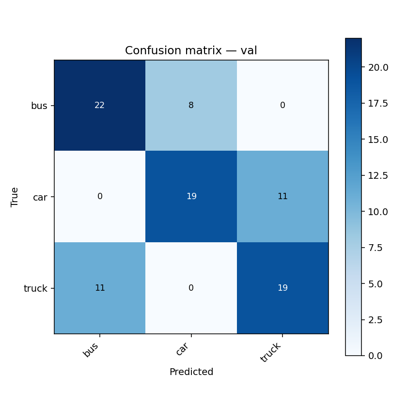

# ModelAudit Agent

**Autonomous ML/CV experiment diagnosis — tool-using AI built on verifiable metrics.**

ModelAudit diagnoses image-classification (and other multiclass classification) experiments from a predictions CSV. Instead of asking an LLM to guess accuracy or explanations, deterministic Python tools compute metrics, calibration, top-confidence failures and cross-split duplication. An optional OpenAI Agent chooses which tool to invoke and explains the results.

> **Status:** Working v0.1 MVP. Offline pipeline and tests run without an API key. LLM mode needs `openai-agents` and a separately billed OpenAI API key. Not an image inference/training system yet.

## Demo screenshot / examples

An offline demo generates `outputs/demo/report.md`, `metrics.json`, and three plots (see `examples/` for sample output). For a quick code review, inspect `src/modelaudit/agent.py` and `src/modelaudit/analysis.py`.



## Features

- **Metrics:** per-split accuracy, macro/weighted F1, precision/recall per class, confusion matrices.
- **Confidence calibration:** top-label expected calibration error (ECE), 10 equal-width bins and reliability plot.
- **Failure analysis:** highest-confidence misclassifications with sample identifiers, optional group and image paths.
- **Split-integrity checks:** shared sample IDs across train/val/test; optional SHA-256 hashes of local image files, with sandboxed path resolution.
- **Explainability with constraints:** rule-based evidence flags, human-readable report with appropriate limitations; optional LLM uses tools and may propose follow-up experiments.
- **Engineering:** typed modules, CLI, deterministic seeded demo, reproducible output artifacts, pytest tests, configurable model.

## Architecture

```text
User prompt / CLI
       |
       v
Agent controller (OpenAI Agents SDK) --------- optional, API mode
       | decides which tool to call
       v
Tools: overview | metrics | hard failures | leakage | report
       |
       v
AuditEngine --> CSV validator --> deterministic audit (pandas/numpy)
       |
       +--> metrics.json
       +--> confusion_matrix.png / per_class_recall.png / reliability_diagram.png
       +--> report.md
```

## Quickstart

Python 3.10+ recommended. Commands from repo root.

```bash
python -m venv .venv
# Windows PowerShell: .\.venv\Scripts\Activate.ps1
# macOS / Linux: source .venv/bin/activate
pip install -e '.[dev]'
modelaudit demo
pytest -q
```

**Offline real dataset:**

```bash
modelaudit audit --csv data/your_predictions.csv --out outputs/my_experiment
```

**Autonomous Agent:**

```bash
pip install -e '.[agent,dev]'
# Windows PowerShell:
# $env:OPENAI_API_KEY = "sk-..."
# macOS / Linux:
# export OPENAI_API_KEY="sk-..."
modelaudit agent --csv data/demo_predictions.csv --question "分析验证集性能下降的原因，检查数据泄漏并生成报告" --out outputs/agent
```

Agent conversation state is stored in SQLite via the SDK. Model can be selected using `MODELAUDIT_MODEL`, default `gpt-4.1-mini`; availability and pricing depend on your API account.

## Input schema

Required CSV columns:

| Column | Example | Meaning |
|---|---|---|
| `sample_id` | `val-001` | Input identifier, useful for tracing errors |
| `split` | `val` | `train`, `val`, or `test` |
| `y_true` | `truck` | Ground truth class |
| `y_pred` | `bus` | Predicted class |
| `confidence` | `0.94` | Probability assigned to **predicted** class, between 0 and 1 |

Optional: `group` (e.g., daylight/weather/source, reported only if group has >=5 samples) and `image_path` (relative to the CSV folder for identical-byte hashing; no image content analysis).

Example:

```csv
sample_id,split,y_true,y_pred,confidence,group
train-1,train,car,car,0.97,day
val-1,val,truck,bus,0.94,night
val-2,val,bus,bus,0.84,day
```

## Project structure

```text
ModelAudit-Agent/
├── src/modelaudit/
│   ├── __init__.py
│   ├── __main__.py
│   ├── cli.py           # entry point (demo / audit / agent)
│   ├── data.py          # input validation
│   ├── analysis.py      # deterministic metrics, leakage and evidence flags
│   ├── report.py        # figures, markdown, JSON, engine
│   ├── agent.py         # 5 LLM tools + session + constraints
│   └── demo.py          # seeded synthetic predictions
├── tests/test_audit.py
├── data/demo_predictions.csv
├── examples/            # generated outputs to preview
├── docs/roadmap.md
├── pyproject.toml
├── .env.example
├── .gitignore
└── README.md
```

## Correctness and safety boundaries

- Python tools are the authoritative numerical source. Do not hallucinate metrics from an LLM summary.
- A train-validation gap suggests investigation, **not proof** of overfitting.
- Repeated sample IDs may indicate collisions, **not proof** of data leakage. Identical hashes reflect exact-byte copies only.
- ECE is a coarse, bin-based calibration estimator and depends on how confidence is defined.
- The tool API cannot browse arbitrary user paths. Optional image hashing rejects paths outside the CSV folder and skips files >50MB; CSV is bounded to 35MB and 200k records.
- The script neither launches shell commands from LLM output nor automatically modifies training code or sends data to external services except required agent API content.
- **Privacy:** LLM mode sends selected tool results and chat content to the configured API. Keep private identifiers out of datasets or use offline mode.

## Roadmap

1. **v0.1 (included):** offline metrics, leakage, confidence, reports + optional tool-using Agent.
2. **v0.2:** PyTorch inference adapter for actual images, Grad-CAM visualizations, Streamlit dashboard, MLflow experiment import.
3. **v0.3:** Multi-agent Planner/Diagnostician/Reviewer, controlled ablations, GitHub Actions and benchmark suite.
4. **v1.0:** evaluated recommendations, deployment, access controls, observability and practical failure taxonomy.

## Evaluation plan

- Unit tests for metric correctness, input validation and leakage rules.
- Golden-dataset tests: seed controlled failure patterns and verify alert recall/precision.
- LLM tool-use tests: measure expected tool-call selection across prompts, unsupported-claim rate, and report evidence coverage; store traces and regression cases.
- Ablation: compare raw LLM analysis vs tool-grounded LLM vs deterministic rules.

## Further reading

- [OpenAI Agents SDK](https://openai.github.io/openai-agents-python/)
- [Agents tools](https://openai.github.io/openai-agents-python/tools/)
- [Sessions](https://openai.github.io/openai-agents-python/sessions/)

MIT license — see `LICENSE`.
