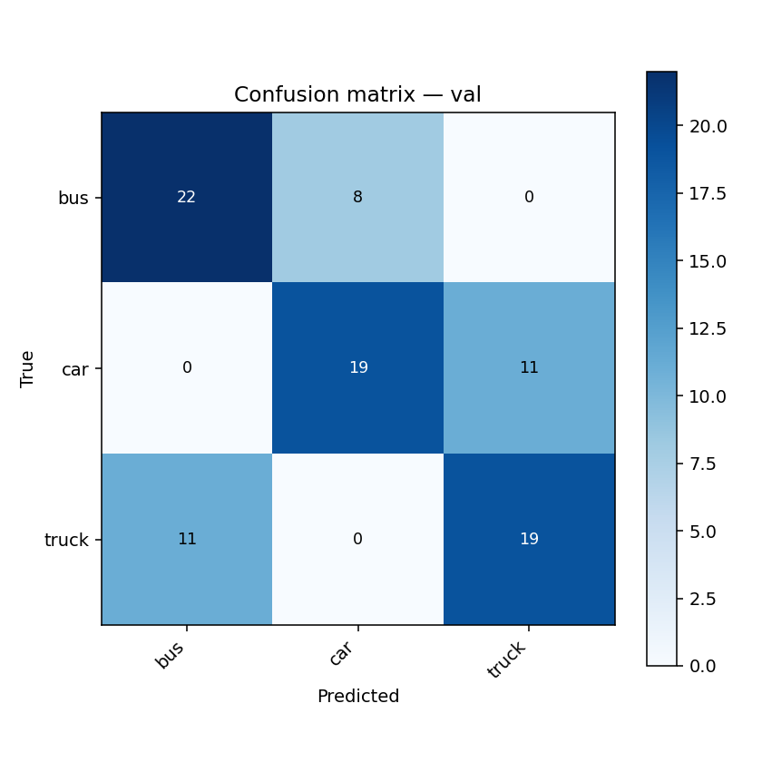
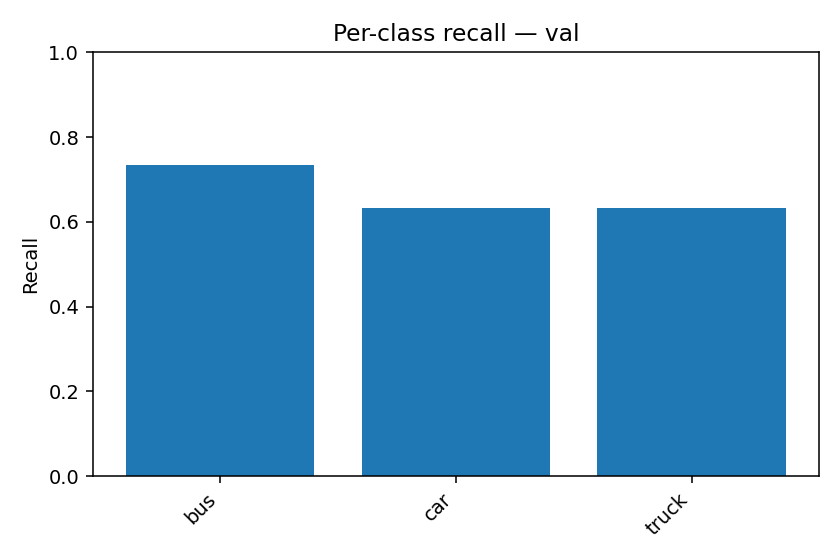
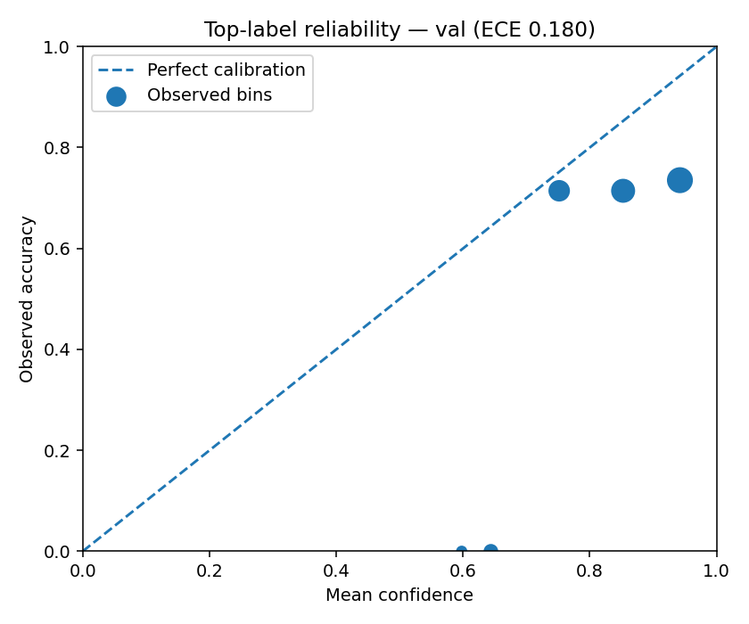

# ModelAudit Agent — Experiment Diagnosis

**Dataset:** `data/demo_predictions.csv`

**Analyzed split:** `val` (val > test > train)

## Executive summary

- Predictions assessed: **300**
- Classes: **3**

## Quantitative evidence

| Split | Samples | Accuracy | Macro F1 | Weighted F1 | ECE |
|---|---:|---:|---:|---:|---:|
| test | 60 | 0.683 | 0.681 | 0.681 | 0.161 |
| train | 150 | 0.987 | 0.987 | 0.987 | 0.137 |
| val | 90 | 0.667 | 0.666 | 0.666 | 0.180 |

### Per-class metrics — val

| Class | Support | Precision | Recall | F1 |
|---|---:|---:|---:|---:|
| bus | 30 | 0.667 | 0.733 | 0.698 |
| car | 30 | 0.704 | 0.633 | 0.667 |
| truck | 30 | 0.633 | 0.633 | 0.633 |

## Evidence-based findings

1. **generalization_gap** (high): train-val accuracy gap = 0.320
   - Next experiment: Inspect augmentation, regularization, split quality and class imbalance; the gap alone does not prove overfitting.
2. **confidence_miscalibration** (medium): val ECE = 0.180
   - Next experiment: Evaluate temperature scaling on a separate calibration split; report ECE alongside accuracy.
3. **high_confidence_errors** (medium): At least 9 of the sampled top errors have confidence >= 0.9
   - Next experiment: Review the sampled labels and visual conditions; look for systematic class confusion.
4. **possible_split_leakage** (high): 3 repeated IDs; 0 cross-split identical image hashes
   - Next experiment: Audit split construction and provenance before trusting validation scores; repeated IDs alone are not conclusive.

## Hard examples (highest-confidence mistakes)

| Sample | True | Predicted | Confidence |
|---|---|---|---:|
| val-033 | car | truck | 0.957 |
| val-012 | car | truck | 0.955 |
| val-021 | car | truck | 0.949 |
| val-078 | car | truck | 0.936 |
| val-081 | car | truck | 0.920 |
| val-048 | car | truck | 0.920 |
| val-000 | car | truck | 0.903 |
| val-030 | car | truck | 0.902 |
| val-051 | car | truck | 0.901 |
| val-024 | car | truck | 0.899 |

## Evidence plots

## Limitations

- This audit analyzes supplied predictions, not neural-network weights or source images.
- ECE estimates depend on binning and confidence interpretation.
- A train/validation gap is a diagnostic signal, not proof of overfitting.
- Duplicate sample IDs can reflect metadata collisions; binary-identical files are stronger evidence.
- Suggestions are hypotheses requiring controlled follow-up experiments.
